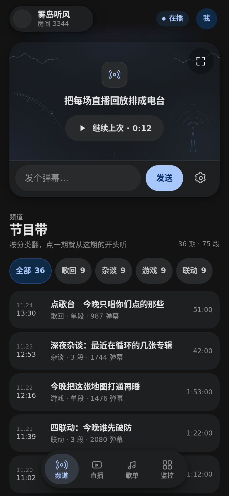

# 哔哩吧啦（BiliBala）

> Android 平台的 B 站直播回放客户端。以「单 APK 内嵌本机 HTTP 服务 + WebView 前端 + Media3 播放内核」的架构，将指定主播的直播回放组织为可连续播放的节目流，并同时提供直播间、实时弹幕、歌单与多路监控能力。

- 适用系统：Android 7.0 及以上（API 24+）
- 编译配置：`compileSdk 35` / `targetSdk 34` / `minSdk 24`
- 当前版本：`8.2.0`（versionCode 34）



## 概述

哔哩吧啦将一位主播的历史直播按时间线组织为「节目带」，用户选定主播后即可像收听电台一样连续播放；同一应用内还提供直播间观看、实时弹幕、歌单播放与多路直播监控。

应用不依赖远程服务端：页面、接口与媒体中转全部运行在本机进程中，抓取到的数据仅写入应用私有目录，不含统计 SDK、广告与账号体系。

## 功能特性

### 回放频道

- 输入主播 UID 后自动识别回放来源，并按歌回、杂谈、游戏、联动等分类组织节目带。
- 点击任意一期即从该期开头播放，播完自动接续下一期；空闲状态提供「继续上次」入口。
- 清晰度最高 1080P；B 站未登录时仅可获取 720P，登录态由用户在设置中自行填写。

### 直播间

- 观看当前直播间画面，支持原画、蓝光、超清、高清多档切换，不可用时逐档回落。
- 弹幕通道使用 `getDanmuInfo` 并结合 wbi 签名，按 `protover 2` 自行解包；登录后可发送弹幕。
- 进入全屏时调用原生横屏接口，而非网页层全屏。

### 弹幕

- 回放弹幕按 6 分钟一段分片拉取，本地以 LRU 策略缓存 12 个会话，并落盘保留 7 天。
- 直播弹幕与回放弹幕共用同一渲染层，由单 canvas 绘制。

### 歌单

- 支持导入歌单、调整顺序，并作为播放队列使用。

### 监控

- 最多同时显示 6 路直播间，横屏默认铺满视口，可切换为完整 16:9 显示。
- 支持「一大多小」焦点布局、长按拖动调整顺序（顺序持久化）。
- 单击任意一路即单独开启该路声音，全局保持单音源；开启前会停止回放。

### 小窗与悬浮窗

- 切换到其他视图时，正在播放的回放会转入页面内小窗继续播放，不中断音频。
- 退至后台时由应用自建的悬浮小窗接管（`TYPE_APPLICATION_OVERLAY`），支持拖动、贴边停靠、双击返回应用与通知栏停止，不依赖系统画中画。

### 播放内核

- 网页内 `<video>` 仅负责画面并保持静音，声音统一交由原生 `Media3 ExoPlayer`（前台服务 + MediaSession），因此锁屏与通知栏均可控制播放。
- 播放位置以 `video.currentTime` 为唯一事实，原生侧仅做漂移校正。

## 下载

- 最新发行版：[github.com/3511440694huang-oss/bilibala/releases](https://github.com/3511440694huang-oss/bilibala/releases)
- 当前版本文件：`bilibala-8.2.0.apk`（6.93 MB）
- SHA-256：`ca3e39777ddfc9b3f6e8ade57b4d2894f7a4ab229f7d0a37a11877da067160ba`

## 安装与首次使用

1. 下载 APK，在系统设置中允许「安装未知来源应用」后安装。
2. 首次启动填写一位主播的 B 站 UID（个人主页网址中的数字部分），点击「检测」确认身份后进入频道。
3. Android 13 及以上系统会请求通知权限；拒绝授权不影响播放，仅通知栏不显示播放控制。
4. 使用悬浮窗需在系统设置中授予「显示在其他应用上方」权限。应用内对应开关会跳转至该设置页；未授权时退至后台不会弹出小窗，也不会自动进入画中画。

## 技术架构

| 层次 | 实现 |
|---|---|
| 前端 | 原生 HTML / CSS / JS，零框架；构建时将 `css/*.css`、`js/*.js` 顺序拼接，并把 `views/*.html` 内联进 `shell.html` |
| 容器 | `WebView` 加载 `127.0.0.1` 本地页面；`AndroidRadio` 桥接向页面暴露播放、全屏、悬浮窗等能力 |
| 服务 | 裸 `ServerSocket` 实现的本地 HTTP 服务，端口 18765–18769 顺延；仅绑定回环地址，并校验 `Origin` 与 `Sec-Fetch-Site` |
| 接口 | `BiliApi` 统一封装 B 站公开接口，全应用共享一条 OkHttp 连接与 Cookie |
| 播放 | `Media3 ExoPlayer` 前台服务负责音频；悬浮小窗使用独立 ExoPlayer 与 `TextureView` 渲染画面 |
| 弹幕 | `LiveChat` 复用同一 OkHttp 连接订阅弹幕网关，转推为 SSE 供页面消费 |

## 构建

仓库分为两部分：`web/` 为前端源码，`android/` 为 WebView 容器、本地服务与播放层。

```bash
# 1. 前端：校验 JS 语法 → 合并样式与脚本 → 内联视图
cd web && bash mk.sh

# 2. 装配：将运行所需文件拷入 APK 的 assets，并注入原生桥接层
python3 assemble.py            # 默认写入 ../android/app/src/main/assets/web

# 3. 打包
cd ../android && bash build.sh :app:assembleRelease
# 产物：android/app/build/outputs/apk/release/app-release.apk
```

根目录的 `./build.sh` 依次执行以上三步。

环境要求：Node（仅用于 `node --check`）、Python 3、JDK 17、Android SDK（`compileSdk 35`）与 Gradle。仓库不包含签名文件，将 `debug.keystore` 放入 `android/keystore/` 可产出可直接安装的 APK，否则输出未签名包。`android/app/src/main/assets/web` 中已提交最新构建产物，因此跳过第 1、2 步也能直接打包。

开发调试：

- `python3 web/mock.py --port 18801` 启动离线开发服务，使用 `web/mockdata/` 中的素材模拟主播、节目、弹幕与直播流；仓库仅提供占位图，`test.mp4` 与 `live.flv` 需自行准备（任意 16:9 视频更名为对应文件名即可）。
- 启动 mock 后，浏览器访问 `http://127.0.0.1:18801/`；`web/js/` 下每个文件为一个模块，修改后重新执行 `mk.sh`。

## 目录结构

```
web/                    前端源码（app.css / app.js / index.html 为构建产物，不入库）
├── css/                样式模块：基础、壳层、频道、弹幕、手势、小窗、动效、直播、监控、歌单、我的
├── js/                 脚本模块：按编号拼接，含核心、频道、播放、直播、监控、设置
├── views/              各视图 HTML 片段，构建时内联
├── assets/             闲置底图与字体
├── mk.sh / md.py       前端构建
├── assemble.py         装配进 Android assets 并注入桥接层
└── mock.py             离线开发服务
android/
├── app/src/main/java/com/replayradio/app/
│   ├── MainActivity.kt     WebView 容器与 AndroidRadio 桥接
│   ├── LocalServer.kt      本地 HTTP 服务
│   ├── BiliApi.kt          B 站接口封装
│   ├── LiveChat.kt         直播弹幕订阅与转推
│   ├── PlaybackService.kt  Media3 前台播放（音频）
│   └── OverlayService.kt   后台悬浮小窗
└── app/src/main/res/       布局与图标资源
```

## 已知限制

- B 站未登录状态下仅可获取 720P；1080P 与发送弹幕需要用户自备登录态。
- 直播优先使用 CDN 直连 FLV，失败时降级本机中转；仅提供 HLS / fMP4 的直播间暂无法在本机播放。
- 监控墙「铺满」模式会裁切画面左右边缘以填满视口，可在工具栏切换为「完整」显示。
- 悬浮小窗需要「显示在其他应用上方」权限；部分系统（MIUI、ColorOS 等）还需单独允许后台弹出界面。

## 版本记录

| 版本 | 主要内容 |
|---|---|
| 8.2.0 | 退至后台改由应用自建悬浮小窗接管，支持拖动、贴边停靠与双击返回；画面改用 TextureView 并实现圆角裁切 |
| 8.1.0 | 监控墙铺满显示、单击单路开声、长按拖动排序；直播间原生横屏全屏；顶栏左右滑动切换主播；下线 24 小时视图 |
| 8.0.0 | 页面内小窗、视图转场动效、直播回放清晰度切换、B 站请求共享连接、闲置底图 |
| 7.0.0 | 前端按新设计语言整体重写（HTML / CSS / JS 三层），后端补齐歌单、表情、动态、章节 |
| 6.0.0 | 更名「哔哩吧啦」，更换应用图标，新增全屏播放 |

## 致谢与许可

本项目以 MIT 许可发布，详见 [LICENSE](LICENSE)。

界面与接口设计参考 [DcC176/replay-radio](https://github.com/DcC176/replay-radio)（Windows / Python 版，MIT 许可），本仓库为其 Android 重写实现。

## 免责声明

本项目仅供个人学习与自用。所有接口均来自 B 站网页端公开使用的接口，不提供任何绕过权限的能力；请遵守 B 站用户协议及相关法律法规，因使用本程序产生的后果由使用者自行承担。
